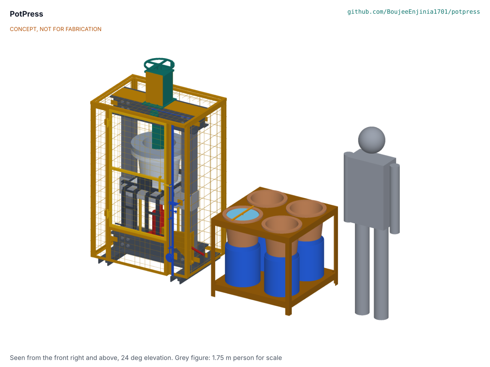
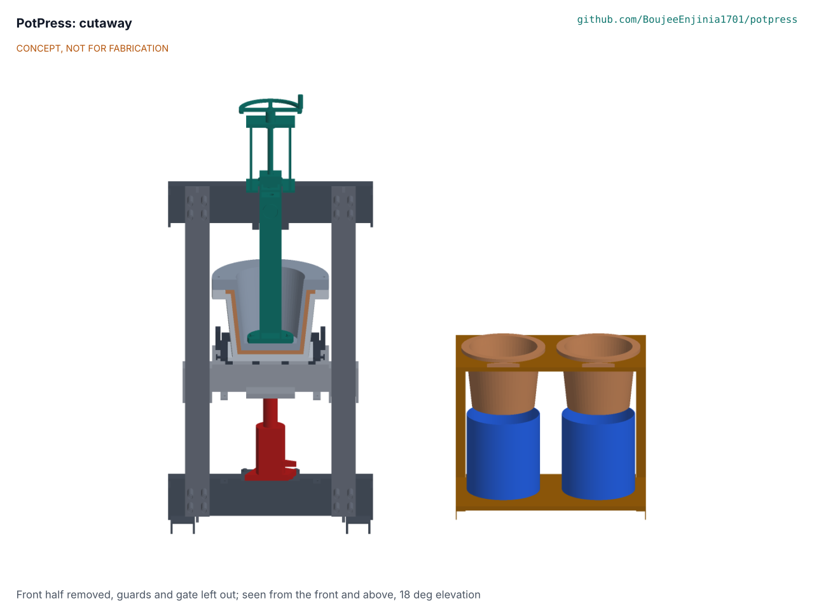
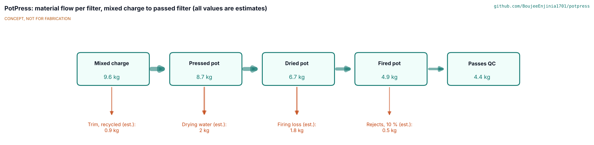
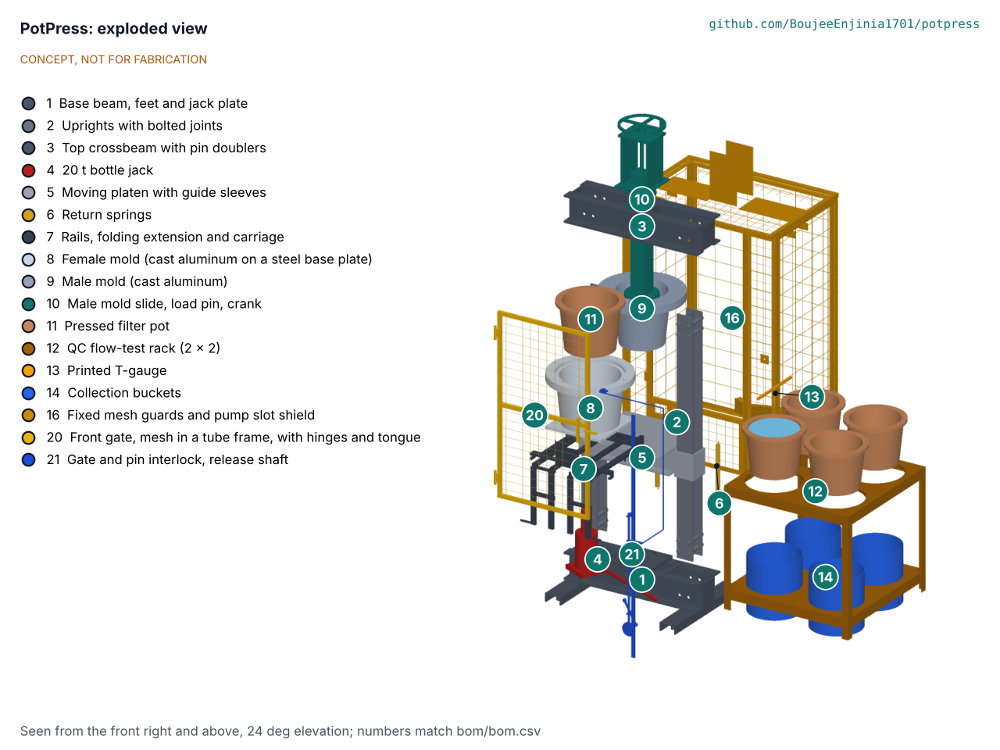

# PotPress design precis

PotPress is a hand-pumped hydraulic press that forms one ceramic pot filter per stroke between a cast aluminum female mold and male mold, plus a four-station rack for the standard one-hour flow-rate test. A 20 t bottle jack on the base lifts a guided platen carrying the female mold against a fixed male mold, whose stem is held by one load pin in the top crossbeam for pressing and raised by a hand crank for loading. One parametric filter geometry drives the molds, the 3D-printed casting patterns and the printed flow gauge. The molds are made 1.087 times the fired filter so the pot comes out of the kiln at the reference size after the clay shrinks (8 % assumed until the partner clay is measured, PPR-DDR-006). The calculations (PPR-CAL-001 v0.11) give a cycle of about 5.2 min and about 69 pots per 6 h, a frame that stays below yield at 1.5 times the jack rating, a working force limit of 5.4 t set by the pump handle, and a parts cost of $1,279 against the $1,060 value-engineering target. The press works inside fixed welded-mesh guards with a hinged front gate interlocked with the jack release (PPR-DDR-003). Every part over 25 kg is lifted on a chain block.

*Figure 1. PotPress with the 2 x 2 QC flow-test rack and a 1.75 m person for scale. The press is shown closed at the end of a pressing stroke, inside its mesh guards with the front gate closed; the mesh is drawn at every eighth wire.*

## How it works

1. **Load.** With the platen down and the jack release open, the female mold rim is at about 943 mm. The operator opens the front gate, swings the hinged rail extension up onto its stop lugs, slides the carriage out 430 mm on the rails, lays a polyethylene release liner in the female mold, places a weighed charge of about 9.6 kg of clay, burnout and water mix, and slides the carriage back to its end stop.
2. **Lower the male mold.** A handwheel on top of the frame turns a self-locking Tr24 x 5 lead screw that runs the male mold stem down 200 mm (40 turns) through the top crossbeam until the pin bores line up. The operator inserts the 60 mm load pin through the beam and stem. From then on the pin, not the screw, carries the press force.
3. **Press.** The operator closes the front gate, which lets the guard-locking interlock free the jack release T-handle; closing the release locks the gate shut. The operator then pumps the jack through the slot in the right side guard, about 70 strokes. The platen, guided by sleeves on both uprights, lifts the female mold about 110 mm and squeezes the charge into the gap between the molds. Two hardened dowels in the female flange enter steel bushes in the male flange, and the male flange lands on a lapped stop face, so the wall (16.3 mm pressed, 15 mm fired) and rim are set by the molds, not by how hard the operator pumps. The working force stays at or under 5.4 t, where the pump handle needs about 148 N with 85 % pump and seal efficiency (D9, decided by Amish on 2026-10-25). Excess mix squeezes into a flash groove at the rim for trimming.
4. **Open and demold.** The operator opens the jack release with the T-handle outside the guard; the platen's weight and two springs return it, and only then does the interlock let the gate open. The operator pulls the pin and cranks the male mold up, leaving its tip 49 mm above the female rim. The carriage slides out onto the rail extension until its hooks meet the tipping pins, and the mold is turned over on them so the pot, still in its liner, comes out onto a drying board. Between loads the rail extension folds down, so the press stands 840 x 655 mm.
5. **Dry, fire, treat.** Drying, firing and silver treatment follow the factory's existing practice and are outside PotPress.
6. **Test.** Fired pots are soaked, hung by their rims in the QC rack over collection buckets, filled to 10 mm below the rim and read after one hour with the printed T-gauge. The reading is corrected to 25 °C with the water temperature.

*Figure 2. Cutaway through the closed press and the QC rack, showing the pressed pot between the molds, the shell molds and the load path.*

*Figure 3. Material flow for one filter, from mixed charge to a filter that passes QC, in kg. All values are estimates from PPR-CAL-001.*

## Main components

Numbers match the exploded view (Figure 4), `bom/bom.csv` and the general arrangement drawing PPR-DWG-001.

*Table 1. Main components.*

| # | Component | Choice | Notes |
| --- | --- | --- | --- |
| 1 | Base beam, feet and jack plate | Two UPN 160 channels 840 mm with a 104 mm gap, a bolted 20 mm jack plate, two UPN 100 feet web up with four M12 floor anchors | Same section as the top beam; base beam 34.2 kg |
| 2 | Uprights | Two UPN 100 channels back to back each side, 1,423 mm, in the beam gaps at 600 mm centers with 2 mm shims and spacer tubes, bolted to both beams with 4 x M16 10.9 per joint | 54 MPa in tension, bolts 117 MPa in double shear at 294 kN; 29.8 kg per pair |
| 3 | Top crossbeam | Two UPN 160 channels, 12 mm web doublers and a 62 mm pin bore at the center, plastic stem guides | 190 MPa at 294 kN; 38.0 kg |
| 4 | 20 t bottle jack | Standard jack, 150 mm stroke, about 60 mm ram, turned 25 degrees so its pump handle passes through the right guard | Uses 110 mm of stroke; working force limited to 5.4 t |
| 5 | Moving platen | Two UPN 140 channels, 6 mm deck, jack pad, 150 mm guide sleeves on the uprights | 39.6 kg |
| 6 | Return springs | Two tension springs | Gravity returns the platen; the springs keep it seated |
| 7 | Rails, hinged extension and carriage | Four flat-bar rails fixed to 290 mm in front of the axis, a 335 mm extension on barrel hinges and stop lugs that folds down, a carriage with hooks on the tipping pins, retaining pins and two lift handles | Moves the female mold out of the pinch zone for loading and demolding |
| 8 | Female mold | Sand-cast A356 cup sized for 8 % clay shrinkage, 480 mm flange with a lapped stop ring, rim counterbore and flash groove, bedded on a 350 x 350 x 15 mm steel base plate with two lifting eye bolt holes; two 16 mm dowels | 39.6 kg with its plate |
| 9 | Male mold | Sand-cast A356 plug open at the top, 15 mm shell and 30 mm tip, 480 mm flange with two steel bushes and two lifting eye bolt holes | 26.3 kg; flange 60 MPa at 294 kN |
| 10 | Male mold slide | SHS 90 x 8 stem 691 mm on a 190 mm disc bolted to the plug floor, pin block, one 60 mm 42CrMo4 load pin, captive nut, Tr24 x 5 lead screw, crank bracket and handwheel | The screw only lifts; the pin carries the load |
| 11 | Pressed filter pot | The product, shown for context | Not costed |
| 12 | QC flow-test rack | 2 x 2 stations, 780 x 780 x 720 mm, steel angle and plywood, for fired pots | Within the 0.8 x 0.8 m of PR-011 |
| 13 | Printed T-gauge | PETG dipstick; 1.0 L is 16.7 mm on the scale | Scale generated from the fired geometry |
| 14 | Collection buckets | 20 L food-grade HDPE | |
| 16 | Fixed mesh guards, pump slot shield and guard fixes | Welded mesh on 25 x 25 x 3 angle frames, 1,413 mm tall: 12.7 x 12.7 x 1.6 mm on both sides and the back; 6.35 x 6.35 x 0.9 mm on two front strips, a lower front panel and a roof; a framed 30 x 272 mm pump slot with a fixed steel tunnel behind it; small-hole plates at the release shaft and pin cable; cover plates on the top beam and crank bracket | All 23 openings meet ISO 13857 Table 4 on paper |
| 20 | Front gate | 572 x 1,085 mm, 20 x 20 x 2 tube frame with 6.35 mm mesh, two lift-off hinges on the left, pull handle and tongue; opens outward to the left | Clears the folded rail extension |
| 21 | Gate interlock and release extension | Release shaft with a notched lock disc and knob outside the guard, a lock rod, a gate slider and a pin slider worked by the pin-presence plunger | Purely mechanical; no electrics |
| 22 | Lifting set | 0.5 t chain block, two-leg sling with shackles, round sling, two M12 eye bolts, hole plugs | Every part over 25 kg; can be hired |

Casting patterns, release liners, fasteners and consumables, the QC timer and thermometer, and the lifting set are BOM items 15, 17 to 19 and 22 and are not modeled. The guards are modeled with their mesh drawn at every eighth wire (101.6 mm) so the views stay readable; the appearance model draws every wire.

*Figure 4. Exploded view with numbered callouts matching the BOM.*

## Key numbers

All values are estimates from PPR-CAL-001, which lists its assumptions and the results against every requirement.

*Table 2. Key numbers at TRL 3.*

| Quantity | Value | Basis |
| --- | --- | --- |
| Filter volume (fired) | 12.30 L to the brim; 9.91 L working | Inner rim 280 mm, floor 230 mm, depth 240 mm (PR-001) |
| Clay shrinkage allowance | Molds and pressed pot 1.087 times the fired size (8 % assumed) | To be measured on the partner clay before patterns are printed |
| Pot masses | Charge 9.59 kg; pressed 8.72 kg; fired 4.88 kg | RDI-C recipe, 1.64 kg/L pressed; factories report 8 to 9.5 kg of mix |
| Mean pressure | 0.18 MPa at 2 t; 0.48 MPa at the 5.4 t working limit; 1.78 MPa at 20 t | 0.1104 m² projected (pressed pot) |
| Frame at 294 kN | Beams 190 MPa, uprights 54 MPa, pin 272 MPa (yield 650), joint bolts 117 MPa, male flange 60 MPa (yield about 80) | S275; 42CrMo4 pin; M16 10.9 bolts; as-cast A356 |
| Deflection between molds | 0.66 mm at 10 t; 1.99 mm at 294 kN | PR-003 met on paper; molds close on a metal stop |
| Travel | 110 mm pressing of 150 mm stroke; 310 mm opening against 291 mm needed (49 mm clear) | PR-005 met on paper |
| Cycle | 5.2 min; 69 pots per 6 h | PR-004 met on paper |
| Pump handle | 55 N at 2 t; 148 N at the 5.4 t working limit; 274 N at 10 t (85 % pump and seal efficiency) | Working force limited to 5.4 t (PR-004; D9, decided by Amish 2026-10-25) |
| Wall evenness | ±1.40 mm as cast; ±0.44 mm finished to templates | PR-002 at risk |
| Flow gauge | 0.1 L is 1.69 mm; 2.3 % per °C near 25 °C | PR-006 met on paper |
| Size and mass | Press 940 x 700 x 1,828 mm guarded, rail extension folded; 352 kg plus about 51 kg of guards; heaviest parts 39.6 kg (female mold, platen); rack 780 x 780 mm | PR-008 and PR-011 met on paper (0.7 m depth limit, no margin) |
| Guarding | 12.7 mm mesh at the sides and back, 85 to 110 mm from moving parts; 6.35 mm mesh on the front, gate and roof, 39 to 77 mm away; pump slot enclosed by a fixed shield; interlock openings closed to 4 and 2 mm gaps | ISO 13857 desk check (PPR-CAL-001, section 15): all 23 openings meet on paper; not yet signed |
| Cost | Press $1,196, QC rack $83, total $1,279 | Value-engineering target: USD 1,060. Estimated cost: USD 1,279 (USD 219 over the target) |

The working force is still an assumption. Henry, Maley and Mehta (2013) formed round-bottom filters with a 2 t car jack ([IJSLE](https://ojs.library.queensu.ca/index.php/ijsle/article/view/4532)); the frame is sized for the full 20 t jack either way. Decided by Amish on 2026-10-02: every structural check stays at the full 20 t jack, and the working force is a process setting found in pressing trials with a partner factory, starting near 2 t and stepping up. Since 2026-10-23 it is capped by the pump handle force (PPR-DDR-006), at 5.4 t since Amish's decision of 2026-10-25 (D9); if trials need more, a separate two-speed pump is proposed to Amish (D6, still open).

## Key design choices

These were decided by Amish on 2026-09-25: go with recommendation (PPR-DDR-001 items 1 to 8 and 10 to 15; PPR-DDR-002), except the guarded version, decided by Amish on 2026-09-26 (PPR-DDR-003).

- **Jack below, pushing the female mold up.** A bottle jack must stand upright, so it sits on the base and lifts the platen, and the male mold hangs from the top beam.
- **Male mold lift by hand crank with one load pin and an interlock.** A standard jack gives only 150 mm of stroke, so the crank provides the other 200 mm of opening. The TRL 2 pair of 30 mm pins fails in bending by calculation; one 60 mm alloy-steel pin carries the force, and a mechanical pin-presence interlock stops the jack release valve closing unless the pin is fully home.
- **Molds cast in aluminum from printed patterns, from lead-free scrap.** Cast as shells, with the cavity finished by hand to printed templates and sized for the clay's shrinkage (PPR-DDR-006). The scrap is A356 cast alloy wheels, sorted before melting, with each melt checked by OES or XRF against EN 601. The fiber-reinforced concrete backed variant stays documented as a low-cost alternative; building it is TRL 4 work and on hold.
- **Welded subassemblies, bolted at the upright joints.** The base beam, top beam, uprights and platen are welded separately and joined with 4 x M16 10.9 bolts at each of the four upright joints (PPR-DDR-004), so no part exceeds 40 kg. Fully welded, the frame would be one 166 kg piece.
- **Molds close on a metal stop.** The male flange lands on the female stop face, so frame stretch does not set the wall; R3 judges deflection at 10 t, a structural check case rather than a working force (D9).
- **Demold by sliding the carriage out and turning the mold over on tipping pins,** on a rail extension that folds down between loads.
- **Manual QC rack with printed T-gauge.** The rack is 2 x 2 stations in 0.8 x 0.8 m; a load-cell logger stays a later option.
- **Default acceptance band 1.0 to 2.5 L/h in the first hour, corrected to 25 °C.** Each factory may set its own band.
- **Value-engineering target $1,060.** This is a hypothetical control target, not a limit. The priced BOM was $984 after the bolted joints and rail hinges, against a $990 target. The guarded version adds $67 and brings the BOM to $1,051, $61 over that earlier target; the target was set at $1,060 on 2026-09-27, since guarding is a safety requirement (PPR-DDR-003). The estimate was then within the target, $9 (0.8 %) under; the constructable design (PPR-DDR-004) and the pump slot shield (2026-10-02) bring it to $1,149, the four guard fixes Amish decided on 2026-10-03, accepting their cost, to $1,169, and the STEM check fixes of 2026-10-23 (PPR-DDR-006) to $1,279, $219 over the target.
- **STEM check fixes (2026-10-23, PPR-DDR-006).** Made under Amish's standing instruction: molds scaled for clay shrinkage, a chain block for every part over 25 kg, the working force limited (6.4 t then, 5.4 t since Amish's D9 decision of 2026-10-25), and sorted A356 scrap with a melt check.
- **Guarded version (decided by Amish, 2026-09-26; PPR-DDR-003).** Fixed welded-mesh guards on the sides, back and roof, and a hinged front gate with a mechanical guard-locking interlock on the jack release. A hand pump has no power to switch off, so the interlock acts on the one thing that lets the jack build pressure: the release valve. With the gate open the release cannot be closed, so pumping moves nothing; with the release closed the gate cannot be opened. This was chosen over two-hand control, which does not suit a one-handed pump lever, and over hold-to-run alone, which a hand pump already is but which leaves the other hand free to reach the molds.

## Safety

> **Safety:** PotPress is a 20 t hydraulic press with heavy moving parts, and the workshop around it handles silica-bearing clay dust and silver compounds. Treat each of these as a hazard at every stage.

- **Crushing and pinch points.** The gap between the molds, the platen and the uprights, and the carriage rails can crush fingers and hands. The guarded version (PPR-DDR-003) encloses them: fixed welded-mesh guards on the sides, back and roof, fixed front strips and a lower front panel, and a hinged front gate. The gate's guard-locking interlock holds the jack release open unless the gate is shut, and holds the gate shut while the release is closed. The pump handle works through a framed slot in the right side guard, well below the platen, with a fixed steel tunnel behind the slot so that only the handle can be reached through it, and the release T-handle sits outside the lower front panel. The carriage has an end stop so it cannot be pushed past the male mold. Keep fingers clear of the rail extension hinges when folding it, and deploy it only onto its stop lugs; the extension cannot be deployed with the gate shut.
- **Guard openings (ISO 13857 desk check, 2026-10-02, rerun 2026-10-03).** Decided by Amish on 2026-10-02: the check is done now as a desk check from the tables and the model's distances, signed by a competent person, and is a hold point before any force above hand pressure. The first run found the 12.7 mm mesh on the front and roof too coarse for its 39 to 77 mm distance from moving parts, the release shaft and pin cable openings too large, and the top beam and crank bracket open from above. Amish decided on 2026-10-03: "PotPress - move forward with the four guard fixes. I accept the cost." The front strips, lower front panel, front gate and roof now carry 6.35 mm (1/4 in) mesh with 0.9 mm wire, about 5.5 mm clear, which Table 4 allows 5 mm from a moving part; plates close the two interlock openings to a 4 mm gap round the release shaft and 2 mm round the pin cable; 3 mm plates cover the top beam from the crank bracket to the beam ends, including the open tops of the upright channels; 2 mm sheet closes the front and back of the crank bracket. The sides and back keep the 12.7 mm mesh, 85 to 110 mm from moving parts, and the 30 x 272 mm pump slot stays enclosed by its fixed inner shield. The rerun check finds every one of the 23 openings meets on paper (PPR-CAL-001, section 15). The check is not yet signed; nothing above hand pressure until it is. The 158 mm the pump handle stands outside the guard while in use is operating space, marked on the floor layout. Never remove a guard or defeat the interlock, and inspect both before each shift.
- **Load pin and stored energy.** One 60 mm pin carries the whole press force. Never press unless the pin is fully home through both beam webs and the stem; the guard includes a pin-presence interlock that stops the jack release closing until the pin is home. Check the bolted upright joints for tightness before each shift. Never press above the 5.4 t working force limit, never add a cheater bar or extension to the pump handle, and never adjust the jack's relief valve. Release pressure fully before opening the gate or pulling the pin.
- **Falling and tipping.** The molds weigh about 40 kg (female, with its plate) and 26 kg, and the press about 352 kg, with its center of mass about 0.8 m up. A push of about 850 N at 1 m tips it forward, so anchor the base to the floor. Lift every part over 25 kg on the chain block, by its eye bolts or a sling, take the eye bolts out and plug the holes before pressing, and wear safety boots. The lead screw is self-locking, so the male mold holds its height if the handwheel is released; still keep hands out from under it.
- **Silica dust.** Dry clay and rice husk ash contain crystalline silica, which causes silicosis. Keep mixing and trimming wet, sweep damp, and wear a fitted P2 or N95 respirator for dry work.
- **Molten aluminum and alloy.** Casting is done by a foundry, not at the press. Scrap containing lead (free-machining alloys, wheel balance weights, brass valve stems) must not reach a mold that touches a drinking-water product: sort the scrap and check each melt.
- **Silver compounds.** Silver nitrate is corrosive to skin and eyes and toxic to aquatic life; handle colloidal silver with gloves and eye protection and never pour it into waterways. Silver treatment is outside PotPress but happens in the same workshop.
- **Heat.** Kilns reach about 900 °C. Kilns are outside PotPress but share the site.
- **Water safety claims.** PotPress makes consistent pots; it does not certify them. A filter that passes the flow test is not proven to remove pathogens. Factories must verify bacteria removal by laboratory testing and follow the CMWG recommendations.

## Open questions

- What pressing force gives a well-consolidated wall with a typical mix? Found in pressing trials with a partner factory, starting near 2 t and stepping up (decided, 2026-10-02).
- Can hand finishing to printed templates reach ±0.3 mm on a 400 mm casting (R2, R7)?
- What is the partner clay's total shrinkage? A test bar fired in the partner's kiln sets `CLAY_SHRINK` before patterns are printed.
- Handwheel height of about 1.8 m: a side crank through a bevel gear would be easier to reach.
- Confirm the demolding method with the potters at the first partner factory; the tipping pins stay for the prototype, and if the potters object the pot is lifted out in its liner (decided, 2026-10-02). Check whether a liner leaves marks that affect flow.
- Choose the first partner factory or organization (left open under the portfolio rule).

Concept media: [blueprint sheet](../media/concept-blueprint.pdf), [interactive 3D model](../media/viewer.html). General arrangement: [PPR-DWG-001](../cad/drawings/PPR-DWG-001.pdf).
